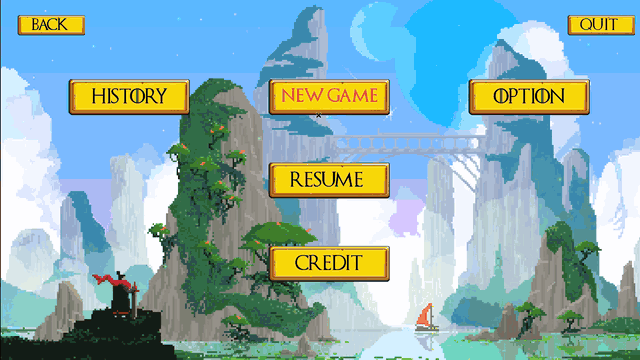
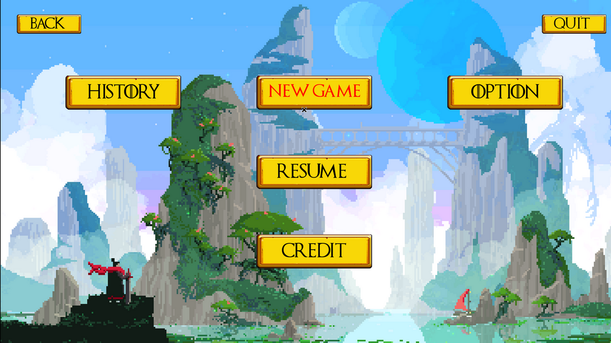
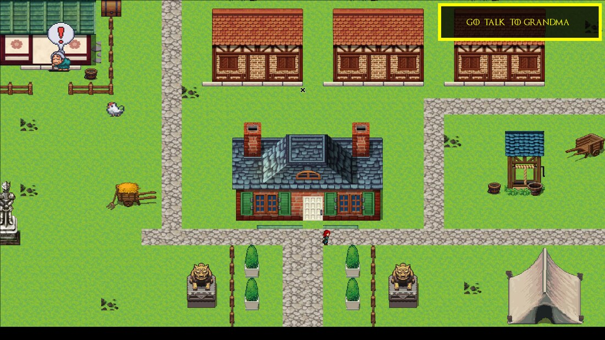

<div align="center">

# Dragon Burden

**A 2D role-playing game in C: explore a village, talk to its people and fight.**

 

<sub>Team of 4 · April 2023</sub>

</div>

<p align="center"></p>


## About the project

*Dragon Burden* is a top-down RPG written in C with CSFML, built over a few weeks by a team of four during the first year at Epitech. You start in a village, get a first quest from the grandmother, and work your way to the dragon's lair through several maps, with an inventory, quests and a fighting mode.

<p align="center"> </p>

## Build and run

```bash
make
./my_rpg
```

Needs the CSFML development package. Click on the title screen, then choose *New game*.

## My contribution

18 commits, about 3,900 lines added in April 2023.

- **Menus**: the title screen with its animation, and the main menu with all its buttons (history, options, credits, quit)
- **Maps**: the village and the other maps, how the player moves between them, and collisions with every building
- **Quests**: the first quest with the grandmother, and the check that blocks the way to the dragon's lair until the quest is done
- **Gameplay**: the inventory menu, sprites, and the transition to and from fighting

## Team

Wilson Bordichon, Yanis Harkouk, Eva Legrand and a fourth teammate.
